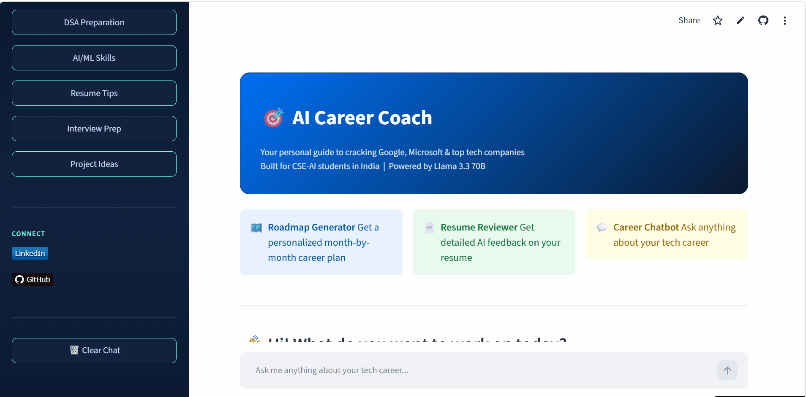

# 🎯 AI Career Coach

A smart AI-powered career guidance chatbot built specifically for CSE and AI engineering students in India who want to crack top tech companies like **Google, Microsoft, Amazon, and Meta**.
**Live Demo:** https://ai-career-chatbot-fgp97hihugsowfsnwfawbb.streamlit.app/
*(May take 15 seconds to wake up on first load — free hosting)*

## 🎥 App Preview


---

## 💡 Why I Built This

As a 3rd year CSE-AI student myself, I struggled to find clear, specific career guidance. Most resources are either too generic or too expensive. I built this tool to give every student access to personalized, honest, and actionable career advice — for free.

---

## ✨ Features

### 💬 AI Career Chatbot
- Ask anything about your tech career
- Get specific advice for your target company
- Covers DSA, AI/ML skills, certifications, LinkedIn, GitHub
- Remembers your conversation history

### 🗺️ Roadmap Generator
- Fill a form with your current skills and target company
- Get a personalized month-by-month career roadmap
- Includes free resources, project ideas, and interview tips
- Download your roadmap as a text file

### 📄 Resume Reviewer
- Paste your resume text
- Get detailed AI feedback including:
  - Score out of 10
  - Missing skills
  - Weak sections
  - ATS keywords to add
  - Top 3 urgent fixes
- Download your review as a text file

---

## 🛠️ Tech Stack

| Layer | Technology |
|---|---|
| Frontend | Streamlit |
| AI Model | GPT-OSS 120B (via Groq API) |
| Language | Python 3.14 |
| Deployment | Streamlit Cloud |
| Version Control | Git & GitHub |

---

## 🚀 Run Locally

1. **Clone the repo**
```bash
git clone https://github.com/DivyanshiBajpai2007/ai-career-chatbot
cd ai-career-chatbot
```

2. **Install dependencies**
```bash
pip install -r requirements.txt
```

3. **Add your Groq API key**

Create a file `.streamlit/secrets.toml`:
```toml
GROQ_API_KEY = "your_groq_api_key_here"
```
Get a free API key at: https://console.groq.com

4. **Run the app**
```bash
streamlit run app.py
```

---

## 📁 Project Structure

```
ai-career-chatbot/
├── app.py                      # Main chatbot page
├── pages/
│   ├── 1_Roadmap_Generator.py  # Roadmap generator page
│   └── 2_Resume_Reviewer.py    # Resume reviewer page
├── requirements.txt            # Python dependencies
├── .gitignore                  # Hides secrets from GitHub
└── README.md                   # Project documentation
```

---

## 🎓 What I Learned

- Building multi-page web apps with Streamlit
- Integrating LLM APIs (Groq + GPT-OSS 120B; originally Llama 3.3 70B, migrated after Groq retired it)
- Prompt engineering for specific use cases
- Secure API key management
- Git version control and GitHub
- Deploying Python apps to the cloud

---

## 👩‍💻 About the Developer

**Divyanshi Bajpai**
3rd Year CSE-AI Student | Maharana Pratap Group of Institutions, Kanpur
Aspiring AI Engineer at Microsoft/Google

- 🔗 [LinkedIn](https://www.linkedin.com/in/divyanshi-bajpai-79902b309)
- 💻 [GitHub](https://github.com/DivyanshiBajpai2007)

---

## 📄 License

This project is open source and available under the [MIT License](LICENSE).
